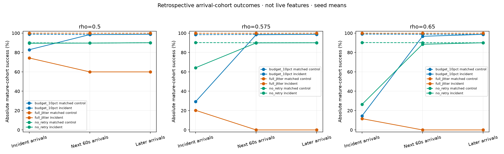
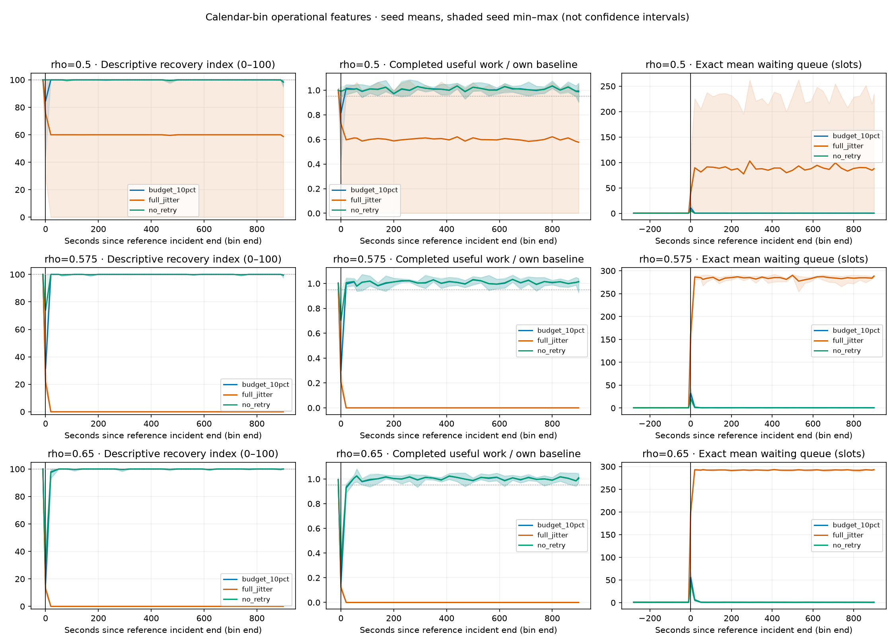

# RetryCascade

**Rust simülasyon çekirdeği + Python deney hattı: retry'ın kullanıcı başarısı,
kaynak tüketimi ve sistemin toparlanmasına etkisini birlikte ölçmek.**

Geçici bir yavaşlama bittiğinde sistem neden bazen toparlanamaz? Timeout alan
istekler sunucuda çalışmaya devam ederken retry'lar aynı iş için ek yük
oluşturabilir. RetryCascade bu geri beslemeyi kontrollü ve yeniden
üretilebilir ayrık olay simülasyonlarıyla inceleyen bir deney aracıdır.

**Durum: 0.2.0 — kullanılabilir simülasyon ve deney workbench'i.** Gerçek
veritabanına bağlanmaz, production ayarı önermez ve evrensel bir "en iyi
retry politikası" seçmez. Gerçek sistem doğrulaması bu sürümde yapılmadı.

## Son sonuçlar

[13 Ekim 2026 sonuç özeti ve provenance](results/followup-2026-10-13/README.md):
630 keşif koşusu, beş yeni seed ve 27.090 zaman serisi satırı. Ledger, checksum,
ortak rastgelelik ve calendar-aligned kontrol denetimleri geçti.
30 confirmation seed kullanılmadı; aşağıdakiler keşif sonuçlarıdır.

Örnek: nominal normal yük %57,5, bağımsız hata oranı %10, Sink kapasitesinde
10 saniyelik %50 kayıp ve strict-RPC timeout sözleşmesi:

| Politika | Arıza sırasında gelenlerin başarısı | Sonraki ilk 60s içinde gelenlerin başarısı | 600s içinde toparlanma |
|---|---:|---:|---:|
| Full jitter + %10 refill budget | %29,18 | %98,34 | 5/5 |
| Full jitter | %20,27 | %0,00 | 0/5 |
| Retry yok | %64,24 | %89,88 | 5/5 |

Budget jitter kaynaklı kalıcı yükü sınırlıyor; fakat arıza anında hiç retry
yapmamaktan daha fazla kullanıcı kaybedebiliyor. Sonrasında ise daha fazla
geçici hatayı kurtarıyor. Yüksek toplam başarı kısa arıza anındaki ağır kaybı
gizleyebildiği için bu dönemler ayrı raporlanır.

Toparlanma grafiği betimleyici indeksi ve iki bileşenini ayrı gösterir:

İndekste 100 bütün kullanıcıların başarılı olduğu anlamına gelmez; yalnız
tanımlı goodput–kuyruk hedeflerine dönüşü özetler. Resmi recovery kuralının
yerine geçmez. Gölge seed min–max aralığıdır, güven aralığı değildir.
5/5 de kesinlik değildir: eligible seed'ler için Wilson95% aralığı yaklaşık
%56,6–%100'dür.

## Hızlı başlangıç

Gerekenler: macOS/Linux, Rust (edition 2024), Python 3.12+, uv ve make.
Docker, PostgreSQL veya harici servis gerekmez. Study lock mekanizması Unix
fcntl kullandığı için Windows runner desteği bu sürümde yoktur.

~~~bash
git clone https://github.com/Toricicim/RetryCascade.git
cd RetryCascade
make setup
make test
make followup-smoke
~~~

24 koşuluk küçük çalışma output/v2-followup-smoke/report.html üretir; dosyayı
tarayıcıda açabilirsin. output/ Git'e eklenmez. Simülasyon zamanı duvar saati
değildir: sistemde dakikalar süren davranış, olaylar arasında atlanarak hesaplanır.

Tek küçük V1 koşusu:

~~~bash
cargo run --locked -p retrycascade-cli -- tests/golden/resolved_smoke_config.json
~~~

## Deneyler

| Komut | Koşu | Amaç |
|---|---:|---|
| make smoke | 28 | Sağlıklı, hata-only, kapasite-only ve birleşik örnekler |
| make pilot | 630 | Dört policy, no-retry, üç budget oranı; üç seed |
| make followup-smoke | 24 | Hizalı kontroller ve istemci sözleşmeleri |
| make followup | 630 | Beş yeni seed ile hedefli ana/sensitivity blokları |
| make discovery | 2709 | Geniş keşif matrisi; confirmation değildir |

Son follow-up; üç yük, üç hata oranı, 3/10s kapasite kaybı ve üç ana kolu
karşılaştırır. 540 ana koşuya 90 client-contract sensitivity koşusu eklenir.
Protokol [configs/research_followup.yaml](configs/research_followup.yaml) içinde
sonuçlardan önce dondurulmuştur. Ayrı V1/V2 protokolleri korunur.

Özel dizin, devam etme, kontrol ve SQL:

~~~bash
cd python
uv run --locked python -m retrycascade run --preset followup --output ../output/my-study --workers 4
# Aynı komut sağlam koşuları doğrular, eksiklerden devam eder.
uv run --locked python -m retrycascade verify --output ../output/my-study
uv run --locked python -m retrycascade reproduce --output ../output/my-study
uv run --locked python -m retrycascade query --output ../output/my-study \
  --sql "SELECT arm, early_post_success_ratio, work_units_per_request FROM cells WHERE rho=0.575 AND failure_rate=0.1 AND trigger_seconds=10 AND client_contract='strict_rpc'"
~~~

--limit 2 kısmi çalıştırır; limitsiz aynı komut devam eder. Başarısız koşular
failure.json ile saklanır; tekrar deneme açık --retry-failed gerektirir.
Binary veya matris değişirse yeni dizin kullanılır. Bozulmuş tamamlanmış
artifact sessizce kabul edilmez. analyze mevcut koşuları tekrar analiz eder;
reproduce saklanan original binary ile bir koşuyu birebir yeniden çalıştırır.

## Mimari ve çıktılar

Python protokolü doğrular, deney seçimini genişletir, canonical resolved JSON
ve SHA-256 üretir. Rust strict JSON'u tüketir, simülasyonu yürütür ve girdi
provenance'ını çıktıya taşır. Python sonuçları Parquet/DuckDB tablolarına,
eşlenmiş karşılaştırmalara ve HTML/Markdown raporlarına dönüştürür.

- plan.json: bütün resolved koşuların değişmez planı.
- execution.json, simulator/ ve source_snapshot/: binary/kod/lock kimlikleri.
- runs/<id>/: resolved config, seçim, summary ve tamamlanma manifest'i.
- runs, cells, paired_effects: seed ve policy karşılaştırmaları.
- recovery_features: geçmiş bin'lerden EWMA, değişim hızı, headroom,
  birikimli açık ve betimleyici 0–100 indeks.
- incident_outcomes: ayrı retrospective arrival-cohort sonuçları.
- analytical_references: IID düşük-yük hesaplarına açıklamalı referanslar.
- analysis_manifest.json: türetilmiş çıktılar için checksum'lar.

Follow-up tabloları JSON, Parquet ve analysis.duckdb içinde bulunur.
[queries/](queries/) altında incident kaybı, zaman serisi ve istemci
sözleşmesi karşılaştırmaları için SQL örnekleri vardır.

Ham deneylerden küçük bir public snapshot çıkarmak için Python klasöründe:

~~~bash
uv run --locked python -m retrycascade.export_snapshot \
  --study ../output/my-study --destination ../results/my-study
~~~

Export doğrulanmış özet ve iki figürü taşır; host yollarını, özel notları,
binary'leri veya ham koşuları GitHub'a taşımaz.

## Modelin sınırları

- Read-like istekler, Source → Transform → Sink, bounded FIFO ve Sink-only
  kapasite kaybı. Immediate, exponential, full jitter ve jitter üzerine
  run-global retry budget bulunur; no-retry kontrol koludur.
- V2 hataları Source admission öncesinde IID oluşur, sunucu işi tüketmez.
  Bu response loss veya genel DB hata modeli değildir. Hata oranı arttığında
  kabul edilen yük de değişebilir.
- Aynı logical request'in retry'larında intrinsic service demand sabittir;
  bağımsız-demand alternatifi ayrı sensitivity'dir.
- Strict RPC ve deadline'a kadar cevabı kabul etme farklı sözleşmelerdir;
  sonuçlar bunlara bağlıdır. Fiziksel cancellation eklenmez.
- İş birimleri CPU, para veya gerçek DB maliyeti değildir. Başarılı kullanıcı
  gecikmesi koşullu bir ölçümdür; failure gecikmesi ve denial da okunmalıdır.
- Toparlanma policy'nin kendi baseline'ına göredir. Düşük başarı baseline'ına
  dönüş yüksek mutlak kullanıcı başarısı demek değildir.

Semantik, indeks formülü, censoring ve doğrulama: [MODEL.md](MODEL.md).
Mevcut sonuçlar özgün araştırma veya production tahmin doğruluğu kanıtı değildir.
Correlated faults, gerçek read-RPC testbed, cancellation, genel DB adapter'ları
ve LLM arayüzü koşullu gelecek işlerdir; zorunlu bitiş koşulları değildir.

## Doğrulama ve sürümleme

make test; Rust formatter, Clippy, unit/config/CLI ve Python testlerini çalıştırır.
GitHub Actions aynı kontrolleri ve uçtan uca follow-up smoke/replay'i çalıştırır.
Testler sözleşmelerin uygulandığını gösterir; dış dünya modelinin doğruluğunu değil.
Bit düzeyinde tekrar üretim aynı binary/platform altında doğrulanır; lognormal
floating-point dönüşümleri farklı platformlarda birebir aynı sonuç garantisi vermez.

Paket sürümü 0.2.0; V1 summary v1.1.0, eski V2 v2.0.0, optional trace içeren
summary v2.1.0. [CHANGELOG.md](CHANGELOG.md) teslim kapsamını listeler.
