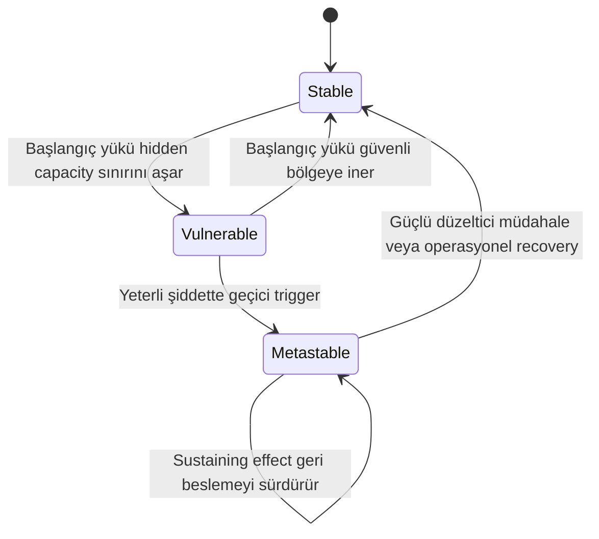
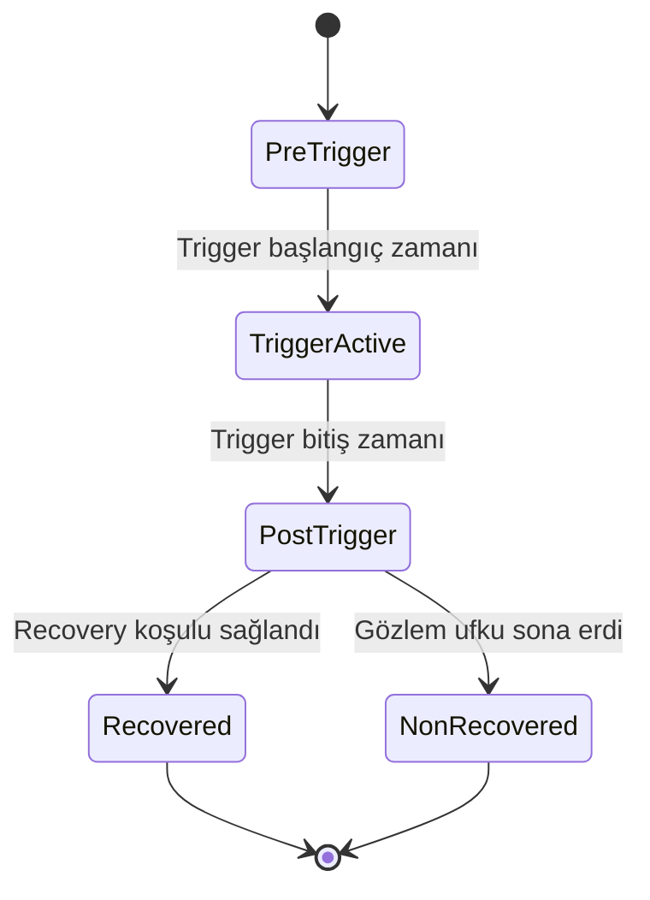

# RetryCascade Kavramsal Durum Modeli

Bu belge, Bronson ve arkadaşlarının metastable failure yaşam döngüsünü RetryCascade bağlamında açıklar. Buradaki durumlar sistemin genel davranış rejimleridir. Rust simülatöründe daha sonra tanımlanacak `logical request`, `attempt` ve kuyruk yaşam döngüsü durumlarıyla karıştırılmamalıdır.

## Durum diyagramı



Mermaid desteklemeyen ortamlarda aynı diyagram:

```text
                         yük güvenli bölgeye iner
               ┌──────────────────────────────────┐
               │                                  │
               ▼                                  │
          ┌──────────┐   artan başlangıç yükü   ┌────────────┐
BAŞLANGIÇ →│  STABLE  │ ───────────────────────→ │ VULNERABLE │
          └──────────┘                           └────────────┘
               ▲                                      │
               │                                      │ yeterli şiddette
               │                                      │ geçici trigger
               │                                      ▼
               │                                ┌────────────┐
               └────────────────────────────────│ METASTABLE │
                 güçlü müdahale veya recovery   └────────────┘
                                                       │  ▲
                                                       └──┘
                                                  sustaining effect
```

## Durumların anlamı

### Stable

Sistem normal yükü karşılar ve tanımlanan geçici trigger sonrasında dış müdahale olmadan toparlanabilir. Bu durum sıfır hata veya sıfır kuyruk anlamına gelmez; trigger bittikten sonra biriken işin azalması ve sistemin normal çalışma bölgesine dönmesi beklenir.

### Vulnerable

Sistem dışarıdan sağlıklı görünebilir ve gelen logical request'leri başarıyla tamamlayabilir. Ancak kapasite payı küçüktür. Belirli şiddetteki bir trigger, retry kaynaklı work amplification oluşturarak sistemi metastable duruma taşıyabilir.

Vulnerable durum doğrudan arıza değildir. Her trigger da geçiş oluşturmak zorunda değildir. Geçiş; başlangıç yüküne, trigger süresine, timeout'a, retry politikasına, kuyruk sınırına ve servis kapasitesine bağlıdır.

### Metastable

Geçici trigger sona erdiği hâlde düşük goodput, yüksek kuyruk veya yüksek attempt yükü devam eder. Bunun nedeni başlangıçtaki trigger değil, sistem içinde oluşan sustaining effect'tir.

RetryCascade kapsamında bu durum sonsuza kadar süren matematiksel bir özellik olarak yorumlanmaz. Ana değerlendirmede, trigger sonrasındaki `H = 600 saniye` gözlem ufku içinde operasyonel recovery koşulunun sağlanmaması `operational non-recovery` olarak kaydedilir. Sonuç ayrıca `H = 300` ve `H = 900 saniye` ile duyarlılık analizine alınacaktır.

## Geçişlerin anlamı

### Stable → Vulnerable

Başlangıç yükü artar ve sistemin hata durumunda kendi kendini iyileştirebildiği hidden capacity sınırını aşar. Sistem hâlâ normal goodput üretebilir; değişen şey trigger karşısındaki güvenlik payıdır.

### Vulnerable → Metastable

Geçici bir yavaşlama veya kesinti kuyruk ve timeout sayısını artırır. Retry'lar aynı logical request için yeni attempt'ler üretir. Toplam fiziksel iş servis kapasitesini aşarsa pozitif geri besleme başlayabilir.

```text
artan kuyruk
→ artan gecikme
→ daha fazla timeout
→ daha fazla retry attempt'i
→ artan kuyruk
```

### Metastable → Metastable

Trigger artık etkin değildir; ancak work amplification kapasiteyi tüketmeye devam eder. Bu self-loop, sustaining effect'i temsil eder.

### Metastable → Stable

Geri besleme kırılır ve sistem yeniden normal çalışma bölgesine döner. Bu geçiş retry'ların sınırlandırılması, giriş yükünün ciddi biçimde azaltılması, yük atma veya kapasitenin artırılması gibi güçlü bir müdahaleyle gerçekleşebilir. Bazı koşullarda sistem dış müdahale olmadan da toparlanabilir; simülasyonda bunun süresi ölçülecektir.

Bu dış veya politika-temelli düzeltici müdahaleler **mitigation** olarak adlandırılır. RetryCascade'de retry budget ve load shedding mitigation işlevi görebilir. Bir mitigation'ın sistemi toparlaması tek başına yeterli başarı ölçütü değildir; reddedilen veya yarıda bırakılan logical request maliyeti de raporlanmalıdır.

## Simülasyon koşusunun gözlem aşamaları

Kavramsal sistem durumlarından ayrı olarak her deney koşusu zaman içinde şu aşamalardan geçecektir:



- **Pre-trigger:** Sistemin trigger öncesindeki temel davranışının gözlendiği dönem.
- **Trigger active:** Geçici kapasite kaybı veya yavaşlamanın uygulandığı dönem.
- **Post-trigger:** Trigger kaldırıldıktan sonra sistemin toparlanmasının izlendiği dönem.
- **Recovered:** Önceden tanımlanmış operasyonel recovery koşulu sağlandı.
- **Non-recovered:** Ana gözlem ufku içinde recovery koşulu sağlanmadı.

Recovery için kullanılacak kesin metrik eşikleri ve ne kadar süre boyunca sağlanmaları gerektiği, Gün 2'de `research_protocol.yaml` içinde sonuçlar görülmeden önce dondurulacaktır.

## Temel kavramlar

- **Logical request:** Kullanıcının veya dış sistemin gerçekleştirmek istediği tek yararlı iş.
- **Attempt:** Bir logical request'i tamamlamak için sisteme gönderilen her fiziksel deneme.
- **Retry:** Önceki attempt başarısız olduğunda veya zamanında cevap vermediğinde oluşturulan yeni attempt.
- **Timeout:** Bir attempt için izin verilen bekleme süresinin dolması.
- **Load:** Dışarıdan sisteme sunulan logical request hızı.
- **Goodput:** Başarıyla tamamlanan yararlı logical request hızı.
- **Trigger:** Sistemi geçici olarak kötü duruma iten dış olay.
- **Sustaining effect:** Trigger bittikten sonra kötü durumu sürdüren iç geri besleme mekanizması.
- **Mitigation:** Sustaining effect'i kırmak veya yük-kapasite dengesini yeniden kurmak için uygulanan düzeltici müdahale.
- **Work amplification:** Bir logical request için birden fazla fiziksel attempt üretilmesi nedeniyle toplam iş miktarının artması.
- **Operational recovery:** Trigger sonrasında önceden belirlenen performans koşullarının yeniden sağlanması.

## Kaynak

Bronson, N., Aghayev, A., Charapko, A. ve Zhu, T. (2021). *Metastable Failures in Distributed Systems*. HotOS '21. https://doi.org/10.1145/3458336.3465286
